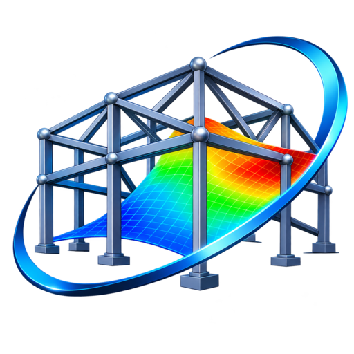

# OmniFrame 3D — Análise Estrutural Tridimensional por Elementos Finitos (3D Space Frame & Truss FEA Suite)

**Plataforma desktop nativa de engenharia para análise estática linear tridimensional (FEA) de pórticos e treliças espaciais em Windows, desenvolvida em C++23 moderno, Qt 6.11.1, Eigen 3.4.0 e OpenGL 3.3 Core Profile. Implementa formulação matricial exata de viga-coluna de Euler-Bernoulli com 12 graus de liberdade por elemento (6 DOFs por nó), solver direto esparso de Cholesky (`SimplicialLDLT` com ordenação AMD), recuperação contínua de esforços via polinômios cúbicos de Hermite, viewport de alta definição (SSAA até 200%, MSAA GPU e suavização subpixel SDF por shader) e temas claro/escuro dinâmicos com suporte bilíngue integral (`pt-BR` / `en-US`).**

[](https://github.com/fernandoncidade/OmniFrame_cpp/releases/tag/v2026.11.13.0)
[](CMakeLists.txt)
[](CMakeLists.txt)
[](https://eigen.tuxfamily.org)
[](docs/architecture.md)
[](docs/compliance.md)
[](https://apps.microsoft.com/detail/OmniFrame3D)
[](https://apps.microsoft.com/detail/OmniFrame3D)
[](LICENSE)
[](docs/licensing.md)
[](docs/security-model.md)

<p align="center">
  <a href="docs/user-guide.md">📖 Guia do Usuário / User Guide</a> •
  <a href="docs/architecture.md">🏗️ Arquitetura / Architecture</a> •
  <a href="docs/compliance.md">📋 Conformidade / Compliance</a> •
  <a href="docs/security-model.md">🛡️ Privacidade &amp; Segurança</a> •
  <a href="docs/cli-reference.md">💻 CLI</a> •
  <a href="docs/licensing.md">⚖️ Duplo Licenciamento / Dual Licensing</a> •
  <a href="https://apps.microsoft.com/detail/OmniFrame3D">🪟 Microsoft Store</a><br>
  <b>Selecione o idioma / Select language:</b><br>
  <a href="#ptbr">🇧🇷 Português (BR)</a> •
  <a href="#enus">🇺🇸 English (US)</a>
</p>

---

<p align="center">
  
</p>

---

## <a id="ptbr"></a><a id="português-br"></a>🇧🇷 Português (BR)

> **Observação:** Este repositório contém o código-fonte aberto e a documentação de conformidade do **OmniFrame 3D** (implementação nativa em **C++23**, **Qt 6.11.1**, **Eigen 3.4.0** e **OpenGL 3.3 Core**), disponibilizado sob arquitetura transparente de **Duplo Licenciamento** (**GNU AGPLv3** para o código-fonte público no GitHub e **EULA Oficial + CLC** para o pacote binário assinado distribuído gratuitamente na Microsoft Store, com execução 100% local e offline). Instale a edição oficial assinada digitalmente através do link: [Instalar via Microsoft Store](https://apps.microsoft.com/detail/OmniFrame3D).

<details>
<summary><b>Clique para expandir / recolher a documentação em Português (BR)</b></summary><br>

O **OmniFrame 3D** (Versão 2026.11.13.0) é uma plataforma nativa desktop de engenharia para simulação estrutural no Windows, desenvolvida em **C++23 moderno** e **Qt 6.11.1** para engenheiros estruturais, engenheiros civis, projetistas mecânicos, pesquisadores e estudantes.

Diferente de suítes comerciais de FEA em caixa-preta que bloqueiam cálculos atrás de assinaturas caras, armazenamento obrigatório em nuvem e solvers opacos, o **OmniFrame 3D** foi concebido para entregar transparência matemática integral, soberania absoluta de dados locais (`Local-First`) e alto desempenho computacional em álgebra matricial esparsa:

> **“Quais são os deslocamentos nodais, as reações de apoio e os diagramas contínuos de esforços internos ($N, V_y, V_z, T_x, M_y, M_z$) ao longo de cada elemento tridimensional sob combinações reais de carregamento?”**

```text
Elemento Espacial de Viga-Coluna 3D (Nós i -> j)
 ├── 12 Graus de Liberdade: (ux, uy, uz, θx, θy, θz) por nó
 │    ├── Rigidez Axial: EA/L
 │    ├── Rigidez Torcional (Saint-Venant): GJ/L
 │    └── Flexão Biaxial e Cisalhamento: 12EI/L³, 6EI/L², 4EI/L, 2EI/L
 ├── Transformação Espacial [T] com Ângulo Roll (γ / ψ) e Condensação de Rótulas
 ├── Solver Esparso Direto de Cholesky: Eigen SimplicialLDLT (Ordenação AMD)
 ├── Recuperação Contínua de Esforços: Polinômios Cúbicos de Hermite + FEF
 └── Viewport OpenGL 3.3 Core (GLSL 330 Phong, SSAA até 200%, MSAA 16×, Shader SDF)
```

---

### ⚖️ Manifesto e Autorização Legal do Titular dos Direitos Autorais

> **Declaração Expressa de Fernando Nillsson Cidade:**  
> Eu, **Fernando Nillsson Cidade**, na qualidade de único autor, criador original e titular exclusivo dos direitos autorais do projeto **OmniFrame 3D**, **autorizo o uso, estudo, cópia, modificação, compilação e distribuição do código-fonte público deste repositório** nos exatos termos do arquivo **[LICENSE](LICENSE)** (**GNU Affero General Public License v3 — GNU AGPLv3**, identificador SPDX `AGPL-3.0-only`), ressalvada a proteção nominal de nome e marca sob a Seção 7(e) (`"OmniFrame 3D"`).  
> Qualquer versão modificada, extensão ou obra derivada do código-fonte público deve preservar a atribuição da autoria original e disponibilizar o código-fonte correspondente sob a mesma licença **GNU AGPLv3**.  
> **Liberdade para Documentação Institucional em `source/assets/`:** Os textos de conformidade contidos em [`source/assets/`](source/assets/COPYRIGHT/AVISO%20DE%20COPYRIGHT%20E%20MARCA%20REGISTRADA_pt_BR.txt) (`ABOUT`, `CLC`, `COPYRIGHT`, `EULA`, `LICENSES`, `NOTICES`, `PRIVACY_POLICY` e `RELEASE`) foram elaborados para viabilizar a distribuição oficial na Microsoft Store; o autor **autoriza expressamente** que desenvolvedores e forks alterem, excluam, adicionem ou adaptem tais documentos em suas próprias distribuições, observada a legislação de suas jurisdições e diretrizes de cada plataforma.  
> **Limite do Binário Oficial Assinado (Microsoft Store):** A edição empacotada em MSIX e assinada digitalmente pelo autor é distribuída **gratuitamente** na Microsoft Store sob o respectivo **[EULA Oficial](source/assets/EULA/EULA_pt_BR.txt)** (em conformidade com os Termos de Licença Padrão para Aplicativos da Microsoft Store) e **[Esclarecimento Comercial — CLC](source/assets/CLC/CLC_pt_BR.txt)**. É expressamente vedada a revenda comercial paga, a apropriação indevida da marca ou a republicação não autorizada por terceiros do pacote binário oficial assinado pelo autor.  
> **Canal de Suporte, Independência da Microsoft e Isenção Legal:** A **Microsoft NÃO presta suporte ao cliente nem cobre este software sob a Política de Privacidade da Microsoft**. Todo eventual suporte técnico do autor é prestado **exclusivamente por e-mail (`linceu_lighthouse@outlook.com`) e pelas abas Issues/Discussions do GitHub**, **em regime voluntário de melhores esforços (best-effort), conforme disponibilidade e sem obrigação de urgência, prazo ou SLA**. O software constitui ferramenta auxiliar de cálculo elástico e estudo fornecida **"NO ESTADO EM QUE SE ENCONTRA" ("AS IS")**, sem garantias e com integral isenção legal do autor quanto à aplicação definitiva em obras reais. Consulte [`docs/licensing.md`](docs/licensing.md#ptbr).

---

### 📌 Ficha Técnica do Projeto

<p align="center">
  
</p>

- **Nome Oficial:** OmniFrame 3D (`3D Structural Frame & Truss FEA Suite`)
- **Autor e Mantenedor:** Fernando Nillsson Cidade *(Desenvolvedor Individual / Pessoa Física)*
- **E-mail Oficial de Suporte (exclusivamente por disponibilidade, sem urgência/SLA):** `linceu_lighthouse@outlook.com`
- **Repositório / Site Oficial:** [https://github.com/fernandoncidade/OmniFrame_cpp](https://github.com/fernandoncidade/OmniFrame_cpp)
- **Download Oficial (Microsoft Store — Edição Gratuita Assinada):** [Instalar via Microsoft Store](https://apps.microsoft.com/detail/OmniFrame3D)
- **Identidade MSIX e Alias no Windows:** `fernandoncidade.OmniFrame3D` · Execution Alias `omniframe.exe` ([`repo/AppxManifest.xml`](repo/AppxManifest.xml))
- **Normas Técnicas Referenciadas para Análise Elástica:** ABNT NBR 8800:2008 (*Estruturas de aço*), ABNT NBR 6118:2023 (*Estruturas de concreto*), AISC 360-22 (*Structural Steel Buildings*) e Eurocode 3 / EN 1993-1-1 ([`docs/compliance.md`](docs/compliance.md#ptbr))
- **Idiomas Suportados Dinamicamente em Tempo de Execução:** Português (Brasil — `pt-BR`) · English (United States — `en-US`)
- **Requisitos de Sistema:** Windows 10 (build `17763+`) / Windows 11 x64, GPU compatível com **OpenGL 3.3 Core Profile**
- **Executáveis Gerados pelos Presets CMake (`CMakePresets.json`):**
  - `OmniFrame.exe` (`build/OmniFrame3D/`): Aplicativo desktop GUI principal em C++23 / Qt 6.11.1 / OpenGL 3.3 Core ([`source/main.cpp`](source/main.cpp))
  - `VersionEditor.exe` (`build/Version/`): Utilitário GUI e CLI (`--check` / `--apply`) de auditoria e sincronização de versão/data ([`mocks/VersionEditor.cpp`](mocks/VersionEditor.cpp))
  - `CompileTranslationsGUI.exe` e `CompileTranslationsTerminal.exe` (`build/CompileLanguage/`): Ferramentas de compilação e validação dos catálogos `.ts` → `.qm`
  - **Suíte Modular CTest (`build/Testes/`):** 7 binários independentes de validação numérica e estrutural (`test_Material`, `test_CrossSection`, `test_Element3D`, `test_CoordinateTransform`, `test_CantileverBenchmark`, `test_EquilibriumReactions`, `test_ProjectSerializer`)

---

### 🌟 Principais Recursos e Módulos Implementados

1. **Formulação Mecânica Exata de Euler-Bernoulli 3D (12 DOFs por Elemento):**
   - Matriz de rigidez local $12 \times 12$ ($[k_e]$) abrangendo rigidez axial ($EA/L$), torção pura de Saint-Venant ($GJ/L$), flexão biaxial acoplada ao cortante ($12EI/L^3$, $6EI/L^2$, $4EI/L$, $2EI/L$), matriz de transformação ortogonal $[T]$ com ângulo de rolamento dos eixos principais (**Roll $\gamma / \psi$**) e condensação estática automática de **rótulas** nas extremidades das barras;
   - Apoios elásticos nodais (**molas $k$**), vínculos rígidos e articulados (**Engastado**, **Articulado Fixo**, **Móvel/Rolete**), **deslocamentos e rotações prescritos**, forças/momentos nodais concentrados e carregamentos distribuídos uniformes com vetores consistentes de forças de engastamento perfeito (*Fixed-End Forces*).
2. **Solver Direto Esparso de Cholesky de Alta Velocidade (`Eigen::SimplicialLDLT`):**
   - Montagem esparsa do sistema global $[K]\{U\} = \{F\}$ em precisão dupla de 64 bits com reordenação redutora de preenchimento **AMD (*Approximate Minimum Degree*)**;
   - Pré-validação automática de integridade geométrica/física (rejeição preventiva de barras com comprimento $L \le 10^{-6}\text{ m}$, parâmetros não positivos ou valores não finitos), detecção automática de **mecanismos cinemáticos** / singularidades e verificação rigorosa do **equilíbrio estático global** ($\sum F = 0$, $\sum M = 0$).
3. **Recuperação Contínua de Esforços & 8 Modos de Diagramas Coloridos:**
   - Reconstrução contínua exata por **polinômios cúbicos de Hermite** ao longo de toda a barra;
   - 8 modos visuais com mapas espectrais contínuos: `Nenhum`, `Deformada 3D`, `Normal N`, `Cortante Vy`, `Cortante Vz`, `Torção Tx`, `Fletor My` e `Fletor Mz`, acompanhados de vetores/setas de reações nodais e controle deslizante de ampliação (`1`–`100`, correspondendo a escala de `1.5x` a `150x`).
4. **Viewport OpenGL 3.3 Core com Pipeline de Alta Definição (`SSAA`, `MSAA` e `Shader SDF`):**
   - Pipeline acelerado por GPU em **GLSL 330** com iluminação Phong, câmera orbital fluida (Botão Direito/Meio para orbitar, `Shift` + arraste para pan, roda do mouse para zoom), atalhos instantâneos (`Vista 3D Isométrica`, `Frontal XZ`, `Planta XY`, `Lateral YZ`, `Enquadrar Tudo [F]`) e seleção espacial exata via **Raycasting 3D** (incluindo multisseleção com `Ctrl`);
   - Menu **Configurações → Qualidade Gráfica e Resolução** permitindo configurar predefinições (`Máximo Automático`, `Ultra Qualidade`, etc.), superamostragem interna **SSAA até 200% (`2.00×`)**, **MSAA por GPU até `16×`**, downsampling **Catmull-Rom 16-tap com nitidez CAS**, suavização analítica subpixel de linhas por **Shader SDF**, VSync, contraste de grade e paletas dedicadas para o **Plano Ativo** (`ObsidianDark`, `PureNight`, `GraphiteDark`, `CleanLight`).
5. **Modelagem em Plano Ativo, Bibliotecas Estruturais & Relatórios Técnicos:**
   - Ferramentas de modelagem rápida (`Selecionar [S]`, `Inserir Nó [N]`, `Inserir Barra [B]`, `Medir [M]`, `Excluir [Del]`) projetadas sobre planos de trabalho `XY`, `XZ` ou `YZ` em qualquer cota, com **Snap Grid** configurável e visualização dos eixos locais das barras;
   - Editores para materiais isotrópicos ($E, \nu, \alpha, \gamma$), seções paramétricas (`Retangular`, `Circular`, `Perfil I/W`, `Tubular` e `Personalizada`), **3 exemplos estruturais prontos para cálculo** (edifício espacial de dois pavimentos, balanço espacial em L e passarela em treliça espacial 3D), salvamento aberto em **`.omniframe` (JSON)** e exportação de memoriais de cálculo em **HTML** e **Markdown**.
6. **Interface Qt 6.11.1 Adaptativa, Janelas Não-Modais (`Z-Order`) & Soberania 100% Offline:**
   - Alternância dinâmica em tempo de execução de **Idioma** (`Português (BR)` / `English (US)`) e **Tema Visual** (`Escuro` / `Claro`) propagada a todos os menus, painéis acopláveis, tabelas de resultados sincronizadas, gráficos do Plano Ativo e **Manual de Instruções pesquisável (`F1`)**;
   - Gerenciamento central de janelas **Modeless** com elevação automática na pilha de profundidade **`Z-Order`** (`WindowZOrderManager`);
   - Operação **100% Local-First e Offline**: zero telemetria, zero sockets de rede e persistência restrita a projetos do usuário mais 3 arquivos locais de preferência (`language.json`, `theme.json` e `graphics.json`) em `%LOCALAPPDATA%\OmniFrame\OmniFrame\`.

---

### 📸 Capturas de Tela da Interface (`pt-BR`)

Capturas reais do **OmniFrame 3D** localizado em **Português (Brasil)** no repositório [`repo/LISTAGEM/pt_BR/`](repo/LISTAGEM/pt_BR), demonstrando a análise de pórtico espacial com renderização SSAA 2.00× / MSAA 16× / Shader SDF e alternância dinâmica entre os temas Escuro e Claro:

<p align="center">
  <strong>Tema Escuro (pt-BR) — Pórtico Espacial de Dois Pavimentos: Deformada 3D, Reações e Tabelas de Resultados</strong><br><br>
  
</p>

<p align="center">
  <strong>Tema Claro (pt-BR) — Alternância Dinâmica de Tema com SSAA 2.00×, MSAA 16× e Shader SDF</strong><br><br>
  
</p>

---

### <a id="microsoft-store-privacidade-suporte"></a>🛡️ Distribuição Microsoft Store, Privacidade e Garantia de Desinstalação Limpa

> [!IMPORTANT]
> **Conformidade Oficial Microsoft Store (Partner Center / MSIX / Políticas v7.20):**
> - **Política de Privacidade Independente (Política 10.5):** **A Microsoft NÃO fornece uma política de privacidade padrão para o OmniFrame 3D, e este software NÃO é coberto pela [Política de Privacidade da Microsoft](https://www.microsoft.com/pt-br/privacy/privacystatement).** A declaração da Microsoft rege exclusivamente os dados da própria loja ou diagnósticos do Windows. Todo o processamento dentro do OmniFrame 3D ocorre localmente na máquina do usuário e é regido estritamente pela [Política de Privacidade do OmniFrame 3D](docs/privacy-policy.md#ptbr).
> - **Suporte do Desenvolvedor Independente:** **A Microsoft NÃO presta suporte ao cliente nem assistência técnica para o OmniFrame 3D.** Todo suporte é oferecido exclusivamente pelo autor (`Fernando Nillsson Cidade`, conta individual) por via eletrônica (`linceu_lighthouse@outlook.com` / [GitHub Issues](https://github.com/fernandoncidade/OmniFrame_cpp/issues)), sem SLA e conforme disponibilidade.
> - **Capacidade Restrita `runFullTrust` (Política 10.6):** Declarada em [`repo/AppxManifest.xml`](repo/AppxManifest.xml) exclusivamente porque o software é uma aplicação Win32 nativa em C++23 / Qt 6.11.1 que utiliza renderização GPU em OpenGL 3.3 Core e diálogos padrão do Windows para salvar/abrir arquivos `.omniframe`, `.html` e `.md`, com zero serviços ocultos, zero drivers de kernel e zero conexões de rede.
> - **Garantia de Desinstalação Limpa (Política 10.2.7):** Remoção completa a qualquer momento via **Configurações do Windows → Aplicativos → Aplicativos instalados** (ou Menu Iniciar → Desinstalar), sem deixar serviços em segundo plano ou modificações residuais no sistema.

| Disposição Regulatória | Referência Oficial no Repositório (`pt-BR`) |
|---|---|
| **Política de Privacidade Própria** | [docs/privacy-policy.md](docs/privacy-policy.md#ptbr) · [Asset Interno (.txt)](source/assets/PRIVACY_POLICY/Privacy_Policy_pt_BR.txt) |
| **Site Oficial do Desenvolvedor** | [https://github.com/fernandoncidade/OmniFrame_cpp](https://github.com/fernandoncidade/OmniFrame_cpp) *(distinto da página da Store)* |
| **Suporte Técnico (Best-Effort)** | `linceu_lighthouse@outlook.com` · [GitHub Issues](https://github.com/fernandoncidade/OmniFrame_cpp/issues) *(sem suporte Microsoft; sem telefone/SLA)* |
| **Licença Oficial do Pacote Store** | [EULA Oficial (PT)](source/assets/EULA/EULA_pt_BR.txt) · [CLC (PT)](source/assets/CLC/CLC_pt_BR.txt) · [GNU AGPLv3 (Código-Fonte)](LICENSE) |
| **Base Legal de Privacidade** | Execução local solicitada pelo usuário — zero coleta de dados pessoais (LGPD Art. 7º, V e IX / GDPR; arquivos locais em `%LOCALAPPDATA%\OmniFrame\OmniFrame\`) |

---

### <a id="quick-start-compilacao"></a>🚀 Compilação, Testes e Execução a partir do Código-Fonte

#### Pré-requisitos
- **Sistema Operacional:** Windows 11 / Windows 10 (build `17763+`) x64;
- **Compilador C++23:** MSVC com suporte integral a C++23 (Visual Studio Build Tools / Community x64);
- **Qt 6.11.1:** Módulos `Core`, `Gui`, `Widgets`, `OpenGL`, `OpenGLWidgets` e `LinguistTools`;
- **Eigen 3.4.0:** Detectado localmente ou obtido automaticamente via `FetchContent` do CMake;
- **Ferramentas de Build:** **CMake 3.28+** e **Ninja**.

#### Compilação via Presets Oficiais (`CMakePresets.json`)
```powershell
# Clonar o repositório oficial
git clone https://github.com/fernandoncidade/OmniFrame_cpp.git
cd OmniFrame_cpp

# Configurar e compilar o aplicativo principal em build/OmniFrame3D/
cmake --preset omniframe-msvc-release
cmake --build --preset omniframe-msvc-release

# Configurar, compilar e executar os 7 testes estruturais CTest em build/Testes/
cmake --preset testes-msvc-release
cmake --build --preset testes-msvc-release
ctest --preset testes-msvc-release --output-on-failure

# (Opcional) Compilar os utilitários independentes de versão e tradução
cmake --preset version-msvc-release && cmake --build --preset version-msvc-release
cmake --preset compile-language-msvc-release && cmake --build --preset compile-language-msvc-release

# Executar o aplicativo gráfico principal
.\build\OmniFrame3D\OmniFrame.exe
```

#### Utilitários Auxiliares via Linha de Comando (`mocks/`)
```powershell
# Auditar consistência de versões e datas no repositório
.\build\Version\VersionEditor.exe --check --root .

# Verificar e compilar catálogos de tradução (.ts -> .qm)
.\build\CompileLanguage\CompileTranslationsTerminal.exe --check --root .
.\build\CompileLanguage\CompileTranslationsTerminal.exe --root . --verbose
```

*(Para detalhes completos de execução e implantação, consulte [`docs/cli-reference.md`](docs/cli-reference.md#ptbr).)*

---

### 🏛️ Escopo Técnico, Responsabilidade Profissional e Isenção ("AS IS")

O **OmniFrame 3D** é uma ferramenta computacional auxiliar de análise matricial **elástica linear de primeira ordem**, destinada ao estudo acadêmico, ensino, pesquisa e pré-dimensionamento estrutural, podendo conter aproximações numéricas ou limitações frente a comportamentos não lineares. Os resultados gerados (deslocamentos, reações e diagramas de esforços) **NÃO substituem verificações completas em regime último/serviço, efeitos de segunda ordem ($P$-$\Delta$ e $P$-$\delta$), instabilidades globais ou locais, combinações normativas específicas (`ABNT NBR 8800`, `NBR 6118`, `AISC 360-22`, `Eurocode 3`) e supervisão formal de profissional legalmente habilitado com emissão de ART/RRT perante o CREA/CAU**. O software é fornecido **"NO ESTADO EM QUE SE ENCONTRA" ("AS IS")**, com todas as suas falhas e sem garantias explícitas ou implícitas; **qualquer aplicação definitiva em projetos executivos, obras reais ou engenharia de produção ocorre por conta e risco exclusivos do usuário, com integral isenção civil, criminal e técnica do autor**.

---

### 📚 Documentação Técnica e Conformidade

- 🏛️ [Arquitetura do Sistema e Deduções Matriciais FEA](docs/architecture.md#ptbr)
- 📋 [Conformidade Normativa e Benchmarks Numéricos](docs/compliance.md#ptbr)
- 🔒 [Política de Privacidade e Soberania de Dados](docs/privacy-policy.md#ptbr)
- ⚖️ [Modelo de Duplo Licenciamento e Checklist Microsoft Store MSIX](docs/licensing.md#ptbr)
- 🛡️ [Modelo de Segurança e Resiliência em C++23](docs/security-model.md#ptbr)
- 📖 [Guia do Usuário](docs/user-guide.md#ptbr) · [Manual Técnico Completo (MANUAL.md)](MANUAL.md#parte-1-manual-de-instruções-português---br)
- 💻 [Referência da Linha de Comando e Utilitários (CLI)](docs/cli-reference.md#ptbr)
- 💡 [Sugestões de Evolução e Backlog Técnico](docs/suggested-issues.md#ptbr)
- 🚀 [Notas de Lançamento da Versão 2026.11.13.0](docs/release-v2026.11.13.0.md#ptbr)

---

### ⚖️ Licenciamento, Suporte e Comunidade

- **Código-Fonte Público (GitHub):** Licenciado sob **GNU Affero General Public License v3 (GNU AGPLv3)** ([`LICENSE`](LICENSE)), protegida sob a Lei nº 9.609/1998, Lei nº 9.610/1998 e tratados internacionais de software livre;
- **Pacote Oficial Microsoft Store (Gratuito):** Distribuído e assinado digitalmente pelo autor sob **[EULA Oficial](source/assets/EULA/EULA_pt_BR.txt)** e **[CLC](source/assets/CLC/CLC_pt_BR.txt)** ([Download Oficial](https://apps.microsoft.com/detail/OmniFrame3D)), respeitando eventuais direitos irrenunciáveis previstos na legislação consumerista aplicável e regras da plataforma;
- **Componentes de Terceiros:** Qt 6.11.1 (`GNU LGPLv3`), Eigen 3.4.0 (`Mozilla Public License 2.0`), Khronos OpenGL/GLSL — atribuições consolidadas em [`source/assets/NOTICES/NOTICE_pt_BR.txt`](source/assets/NOTICES/NOTICE_pt_BR.txt);
- **Suporte e Contribuições:** Atendimento exclusivo por e-mail (`linceu_lighthouse@outlook.com`) e GitHub, voluntário, sem urgência e sem SLA — veja [`CONTRIBUTING.md`](CONTRIBUTING.md#ptbr).

</details>

---

## <a id="enus"></a><a id="english-us"></a>🇺🇸 English (US)

> **Note:** This repository contains the open-source codebase and compliance documentation of **OmniFrame 3D** (native **C++23**, **Qt 6.11.1**, **Eigen 3.4.0**, and **OpenGL 3.3 Core** implementation), distributed under a transparent **Dual-Licensing** framework (**GNU AGPLv3** for public source code on GitHub and the author's **Official EULA + CLC** for the digitally signed binary package distributed free of charge on the Microsoft Store, executing 100% locally and offline). Install the signed official release via: [Install via Microsoft Store](https://apps.microsoft.com/detail/OmniFrame3D).

<details>
<summary><b>Click to expand / collapse English (US) documentation</b></summary><br>

**OmniFrame 3D** (Version 2026.11.13.0) is an engineering-grade, native Windows desktop structural simulation platform designed in **modern C++23** and **Qt 6.11.1** for structural engineers, civil engineers, mechanical designers, researchers, and students.

Unlike commercial black-box FEA suites that lock calculations behind expensive subscription paywalls, forced cloud storage, and opaque solvers, **OmniFrame 3D** is purpose-built to deliver complete mathematical transparency, strict local data sovereignty (`Local-First`), and high-speed sparse matrix computation:

> **“What are the nodal displacements, support reactions, and continuous internal member forces ($N, V_y, V_z, T_x, M_y, M_z$) along each 3D element under realistic load combinations?”**

```text
3D Euler-Bernoulli Beam-Column Element (Nodes i -> j)
 ├── 12 Degrees of Freedom: (ux, uy, uz, θx, θy, θz) per node
 │    ├── Axial Stiffness: EA/L
 │    ├── Torsional Stiffness (Saint-Venant): GJ/L
 │    └── Biaxial Bending & Shear: 12EI/L³, 6EI/L², 4EI/L, 2EI/L
 ├── 3D Spatial Transformation [T] with Roll Angle (γ / ψ) & Hinge Condensation
 ├── Direct Sparse Cholesky Solver: Eigen SimplicialLDLT (AMD Reordering)
 ├── Continuous Internal Force Recovery: Hermite Cubic Polynomials + FEF
 └── OpenGL 3.3 Core Viewport (GLSL 330 Phong, up to 200% SSAA, 16× MSAA, Shader SDF)
```

---

### ⚖️ Copyright Holder Manifesto & Legal Authorization

> **Express Statement by Fernando Nillsson Cidade:**  
> I, **Fernando Nillsson Cidade**, as the sole author, original creator, and exclusive copyright holder of the **OmniFrame 3D** project, **authorize the use, study, copying, modification, compilation, and distribution of the public source code in this repository** strictly under the **[LICENSE](LICENSE)** terms (**GNU Affero General Public License v3 — GNU AGPLv3**, SPDX identifier `AGPL-3.0-only`), reserving name and trademark protection under Section 7(e) (`"OmniFrame 3D"`).  
> Any modified version, extension, or derivative work based on the public source code must retain original authorship attribution and make its corresponding source code available under the same **GNU AGPLv3** license.  
> **Freedom for Institutional Documentation in `source/assets/`:** Compliance texts located under [`source/assets/`](source/assets/COPYRIGHT/COPYRIGHT%20AND%20TRADEMARK%20NOTICE_en_US.txt) (`ABOUT`, `CLC`, `COPYRIGHT`, `EULA`, `LICENSES`, `NOTICES`, `PRIVACY_POLICY`, and `RELEASE`) were authored to satisfy official Microsoft Store submission requirements; the author **expressly grants developers and forks complete freedom** to alter, remove, add, or adapt these documents in their own distributions, provided they comply with applicable laws and platform policies in their respective jurisdictions.  
> **Boundary for the Author's Signed Store Binary (Microsoft Store):** The MSIX package built and digitally signed by the author is distributed **free of charge** on the Microsoft Store under the author's **[Official EULA](source/assets/EULA/EULA_en_US.txt)** (aligned with Microsoft Store Standard Application License Terms) and **[Commercial Licensing Clarification — CLC](source/assets/CLC/CLC_en_US.txt)**. Paid commercial resale, trademark misappropriation, or unauthorized redistribution of the author's official signed binary package is strictly prohibited.  
> **Support Channel, Microsoft Independence & Legal Disclaimer:** **Microsoft does NOT provide customer support and does NOT cover this software under Microsoft's Privacy Statement.** Any developer support is provided **exclusively via email (`linceu_lighthouse@outlook.com`) and GitHub Issues/Discussions**, **on a voluntary best-effort basis according to availability, with no urgency commitment, response guarantee, or SLA**. This software is an auxiliary elastic analysis and educational tool supplied **"AS IS"** without warranties, and the author is wholly exempt from civil, criminal, or technical liability arising from production or construction use. See [`docs/licensing.md`](docs/licensing.md#enus).

---

### 📌 Project Fact Sheet

<p align="center">
  
</p>

- **Official Name:** OmniFrame 3D (`3D Structural Frame & Truss FEA Suite`)
- **Author & Maintainer:** Fernando Nillsson Cidade *(Individual Developer)*
- **Official Support Email (strictly by availability, no urgency/SLA):** `linceu_lighthouse@outlook.com`
- **Official Repository / Website:** [https://github.com/fernandoncidade/OmniFrame_cpp](https://github.com/fernandoncidade/OmniFrame_cpp)
- **Official Download (Microsoft Store — Signed Free Edition):** [Install via Microsoft Store](https://apps.microsoft.com/detail/OmniFrame3D)
- **Windows MSIX Identity & Execution Alias:** `fernandoncidade.OmniFrame3D` · Execution Alias `omniframe.exe` ([`repo/AppxManifest.xml`](repo/AppxManifest.xml))
- **Referenced Standards for Elastic Analysis:** ABNT NBR 8800:2008 (*Steel Structures*), ABNT NBR 6118:2023 (*Concrete Structures*), AISC 360-22 (*Structural Steel Buildings*), and Eurocode 3 / EN 1993-1-1 ([`docs/compliance.md`](docs/compliance.md#enus))
- **Runtime Dynamic Languages:** English (United States — `en-US`) · Português (Brasil — `pt-BR`)
- **System Requirements:** Windows 10 (build `17763+`) / Windows 11 x64, GPU supporting **OpenGL 3.3 Core Profile**
- **Executables Built by CMake Presets (`CMakePresets.json`):**
  - `OmniFrame.exe` (`build/OmniFrame3D/`): Primary C++23 / Qt 6.11.1 / OpenGL 3.3 Core desktop GUI ([`source/main.cpp`](source/main.cpp))
  - `VersionEditor.exe` (`build/Version/`): GUI & CLI (`--check` / `--apply`) version and date synchronization/auditing utility ([`mocks/VersionEditor.cpp`](mocks/VersionEditor.cpp))
  - `CompileTranslationsGUI.exe` and `CompileTranslationsTerminal.exe` (`build/CompileLanguage/`): Translation compilation and verification utilities (`.ts` → `.qm`)
  - **Modular CTest Suite (`build/Testes/`):** 7 standalone numerical and structural validation test binaries (`test_Material`, `test_CrossSection`, `test_Element3D`, `test_CoordinateTransform`, `test_CantileverBenchmark`, `test_EquilibriumReactions`, `test_ProjectSerializer`)

---

### 🌟 Key Capabilities & Implemented Modules

1. **Exact 3D Euler-Bernoulli Beam-Column Formulation (12 DOFs per Member):**
   - $12 \times 12$ local stiffness matrix ($[k_e]$) covering axial response ($EA/L$), Saint-Venant pure torsion ($GJ/L$), biaxial bending coupled with shear ($12EI/L^3$, $6EI/L^2$, $4EI/L$, $2EI/L$), orthogonal 3D transformation $[T]$ with principal axis orientation (**Roll Angle $\gamma / \psi$**), and automatic static condensation of member **end releases (hinges)**;
   - Elastic nodal **spring supports ($k$)**, **Fixed**, **Pinned**, and **Roller** restraints, **prescribed displacements/rotations**, concentrated nodal forces/moments, and uniform distributed member loads using consistent Fixed-End Forces.
2. **High-Speed Sparse Direct Cholesky Solver (`Eigen::SimplicialLDLT`):**
   - Double-precision (64-bit) sparse assembly of $[K]\{U\} = \{F\}$ using **Approximate Minimum Degree (AMD)** fill-reducing reordering;
   - Automated geometric/physical pre-validation (rejecting zero-length members $L \le 10^{-6}\text{ m}$, non-positive constants, and non-finite inputs), automatic **kinematic mechanism** / singularity detection, and strict global static equilibrium verification ($\sum F = 0$, $\sum M = 0$).
3. **Continuous Internal Force Recovery & 8 Color-Mapped Diagram Modes:**
   - Exact continuous diagram recovery via **cubic Hermite interpolation** along every element;
   - 8 visualization modes with continuous spectral gradients: `None`, `Deformed 3D`, `Normal N`, `Shear Vy`, `Shear Vz`, `Torsion Tx`, `Moment My`, and `Moment Mz`, plus nodal reaction arrows and adjustable amplification slider (`1`–`100`, scaling from `1.5x` to `150x`).
4. **OpenGL 3.3 Core Viewport with High-Definition Rendering (`SSAA`, `MSAA` & `Shader SDF`):**
   - Hardware-accelerated **GLSL 330** Phong lighting pipeline, orbital camera (Right/Middle drag to orbit, `Shift` + drag to pan, scroll wheel to zoom), instant preset views (`3D Iso`, `Front XZ`, `Plan XY`, `Side YZ`, `Fit View [F]`), and exact **3D Raycasting** selection (including `Ctrl` multi-selection);
   - **Settings → Graphics Quality & Resolution** dialog with presets (`Auto Max`, `Ultra Quality`, etc.), internal supersampling **SSAA up to 200% (`2.00×`)**, **GPU MSAA up to `16×`**, **Catmull-Rom 16-tap downsampling with CAS sharpening**, analytical subpixel **Shader SDF** line anti-aliasing, VSync toggle, grid contrast control, and dedicated **Active Plane** palettes (`ObsidianDark`, `PureNight`, `GraphiteDark`, `CleanLight`).
5. **Active Working Plane Modeling, Parametric Libraries & Engineering Reports:**
   - Modeling tools (`Select [S]`, `Add Node [N]`, `Add Member [B]`, `Measure [M]`, `Delete [Del]`) projected onto configurable `XY`, `XZ`, or `YZ` working planes with **Snap Grid** and local triad axes display;
   - Built-in editors for isotropic materials ($E, \nu, \alpha, \gamma$), parametric cross-sections (`Rectangular`, `Circular`, `I-Beam`, `Tubular`, and `Custom`), **3 ready-to-solve structural examples** (two-story 3D frame building, 3D L-cantilever, and 3D space truss pedestrian bridge), open **`.omniframe` (JSON)** persistence, and **HTML / Markdown** technical calculation report export.
6. **Adaptive Qt 6.11.1 Workspace, Modeless Windows (`Z-Order`) & 100% Offline Privacy:**
   - Dynamic runtime switching for **Language** (`English (US)` / `Português (BR)`) and **GUI Theme** (`Dark` / `Light`) propagated across all menus, dock panels, synchronized result tables, Active Plane palettes, and the searchable **Operations Manual (`F1`)**;
   - Centralized **Modeless** child-window stack management with click-to-raise **`Z-Order`** control (`WindowZOrderManager`);
   - Strictly **100% Local-First & Offline**: zero telemetry, zero network sockets, and local persistence restricted to user-saved project files plus three preference files (`language.json`, `theme.json`, and `graphics.json`) inside `%LOCALAPPDATA%\OmniFrame\OmniFrame\`.

---

### 📸 Interface Screenshots (`en-US`)

Actual captures of **OmniFrame 3D** localized in **English (US)** stored under [`repo/LISTAGEM/en_US/`](repo/LISTAGEM/en_US), showcasing 3D space frame FEA analysis with SSAA 2.00× / MSAA 16× / Shader SDF rendering and live Dark/Light theme adaptation:

<p align="center">
  <strong>Dark Theme (en-US) — Two-Story 3D Frame: Deformed Shape, Nodal Reactions &amp; Result Tables</strong><br><br>
  
</p>

<p align="center">
  <strong>Light Theme (en-US) — Dynamic Theme Switching with SSAA 2.00×, MSAA 16× &amp; Shader SDF</strong><br><br>
  
</p>

---

### <a id="microsoft-store-privacy-support"></a>🛡️ Microsoft Store Distribution, Privacy, Support & Clean Uninstall

> [!IMPORTANT]
> **Microsoft Store Compliance Summary (Partner Center / MSIX / Policies v7.20):**
> - **Independent Privacy Policy (Policy 10.5):** **Microsoft does NOT provide a default privacy policy for OmniFrame 3D, and this software is NOT covered by the [Microsoft Privacy Statement](https://www.microsoft.com/pt-br/privacy/privacystatement).** Microsoft's Privacy Statement governs only data collected by the Microsoft Store platform or Windows OS. All computation inside OmniFrame 3D runs locally on the user's machine under its own [OmniFrame 3D Privacy Policy](docs/privacy-policy.md#enus).
> - **Independent Developer Support:** **Microsoft does NOT provide customer or technical support for OmniFrame 3D.** All support is offered exclusively by the individual developer (`Fernando Nillsson Cidade`) via email (`linceu_lighthouse@outlook.com` / [GitHub Issues](https://github.com/fernandoncidade/OmniFrame_cpp/issues)), best-effort and with no SLA.
> - **Restricted Capability `runFullTrust` (Policy 10.6):** Declared in [`repo/AppxManifest.xml`](repo/AppxManifest.xml) solely because OmniFrame 3D is a native Win32 C++23 / Qt 6.11.1 desktop application requiring hardware OpenGL 3.3 Core rendering and standard Windows Open/Save dialogs for local `.omniframe`, `.html`, and `.md` files, registering zero background services, zero kernel drivers, and zero network connections.
> - **Clean Uninstall Guarantee (Policy 10.2.7):** Full clean removal at any time via **Windows Settings → Apps → Installed Apps** (or Start Menu → Uninstall), leaving zero background processes or system modifications.

| Regulatory Provision | Official Repository Reference (`en-US`) |
|---|---|
| **Independent Privacy Policy** | [docs/privacy-policy.md](docs/privacy-policy.md#enus) · [In-App Asset (.txt)](source/assets/PRIVACY_POLICY/Privacy_Policy_en_US.txt) |
| **Developer Official Website** | [https://github.com/fernandoncidade/OmniFrame_cpp](https://github.com/fernandoncidade/OmniFrame_cpp) *(distinct from Microsoft Store listing)* |
| **Support Contact (Best-Effort)** | `linceu_lighthouse@outlook.com` · [GitHub Issues](https://github.com/fernandoncidade/OmniFrame_cpp/issues) *(no Microsoft support; no phone/SLA)* |
| **Store Official Package License** | [Official EULA (EN)](source/assets/EULA/EULA_en_US.txt) · [CLC (EN)](source/assets/CLC/CLC_en_US.txt) · [GNU AGPLv3 (Source)](LICENSE) |
| **Privacy Legal Basis** | User-requested local computation — zero personal data collection (LGPD Art. 7, V & IX / GDPR; local preferences in `%LOCALAPPDATA%\OmniFrame\OmniFrame\`) |

---

### <a id="quick-start"></a>🚀 Building, Testing & Running from Source

#### Prerequisites
- **Operating System:** Windows 11 / Windows 10 (build `17763+`) x64;
- **C++23 Compiler:** MSVC with full C++23 support (Visual Studio Build Tools / Community x64);
- **Qt 6.11.1:** `Core`, `Gui`, `Widgets`, `OpenGL`, `OpenGLWidgets`, and `LinguistTools`;
- **Eigen 3.4.0:** Locally detected or automatically fetched via CMake `FetchContent`;
- **Build Tools:** **CMake 3.28+** and **Ninja**.

#### Building with Official Presets (`CMakePresets.json`)
```powershell
# Clone the official repository
git clone https://github.com/fernandoncidade/OmniFrame_cpp.git
cd OmniFrame_cpp

# Configure and build the main application in build/OmniFrame3D/
cmake --preset omniframe-msvc-release
cmake --build --preset omniframe-msvc-release

# Configure, build, and run the 7 structural CTest checks in build/Testes/
cmake --preset testes-msvc-release
cmake --build --preset testes-msvc-release
ctest --preset testes-msvc-release --output-on-failure

# (Optional) Build standalone version and translation utilities
cmake --preset version-msvc-release && cmake --build --preset version-msvc-release
cmake --preset compile-language-msvc-release && cmake --build --preset compile-language-msvc-release

# Launch the main desktop GUI
.\build\OmniFrame3D\OmniFrame.exe
```

#### Companion Command-Line Utilities (`mocks/`)
```powershell
# Audit version and date consistency across repository files
.\build\Version\VersionEditor.exe --check --root .

# Check and compile translation catalogs (.ts -> .qm)
.\build\CompileLanguage\CompileTranslationsTerminal.exe --check --root .
.\build\CompileLanguage\CompileTranslationsTerminal.exe --root . --verbose
```

*(For full execution and deployment details, see [`docs/cli-reference.md`](docs/cli-reference.md#enus).)*

---

### 🏛️ Auxiliary Technical Scope, Professional Responsibility & Exemption ("AS IS")

**OmniFrame 3D** is an auxiliary computational tool for **first-order linear elastic** matrix structural analysis intended for academic study, teaching, research, and preliminary modeling, and may contain numerical approximations or scope limitations relative to nonlinear behavior. Outputs (displacements, support reactions, and internal force diagrams) **MUST NOT be used as sole final evidence in construction designs, civil/structural works, or production decisions without complete manual verification, evaluation of second-order ($P$-$\Delta$ and $P$-$\delta$) and stability effects, full normative load combinations (`ABNT NBR 8800`, `NBR 6118`, `AISC 360-22`, `Eurocode 3`), cross-validation, and formal oversight by a legally licensed engineer (including mandatory professional responsibility filings such as ART/RRT before CREA/CAU where applicable)**. The software is provided **"AS IS"** with all faults and without express or implied warranties; **all engineering deployment occurs at the user's sole risk, with complete legal, civil, criminal, and technical exemption of the author**.

---

### 📚 Technical Documentation & Compliance

- 🏛️ [System Architecture & FEA Matrix Derivations](docs/architecture.md#enus)
- 📋 [Standards Compliance & Numerical Benchmarks](docs/compliance.md#enus)
- 🔒 [Privacy Policy & Data Sovereignty](docs/privacy-policy.md#enus)
- ⚖️ [Dual Licensing & Microsoft Store MSIX Checklist](docs/licensing.md#enus)
- 🛡️ [Security & C++23 Resilience Model](docs/security-model.md#enus)
- 📖 [User Guide](docs/user-guide.md#enus) · [Complete Technical Manual (MANUAL.md)](MANUAL.md#part-2-operations-manual--3d-fea-engineering-guide-english---us)
- 💻 [Command-Line & Utilities Reference (CLI)](docs/cli-reference.md#enus)
- 💡 [Suggested Issues & Technical Backlog](docs/suggested-issues.md#enus)
- 🚀 [Release Notes for Version 2026.11.13.0](docs/release-v2026.11.13.0.md#enus)

---

### ⚖️ Licensing, Support & Community

- **Public Source Code (GitHub):** Licensed under **GNU Affero General Public License v3 (GNU AGPLv3)** ([`LICENSE`](LICENSE)), protected under Brazilian Software Law No. 9.609/1998, Copyright Law No. 9.610/1998, and international open-source treaties;
- **Official Microsoft Store Package (Free):** Digitally signed and distributed by the author under the **[Official EULA](source/assets/EULA/EULA_en_US.txt)** and **[CLC](source/assets/CLC/CLC_en_US.txt)** ([Official Download](https://apps.microsoft.com/detail/OmniFrame3D)), preserving any non-waivable statutory consumer and store-platform rights;
- **Third-Party Libraries:** Qt 6.11.1 (`GNU LGPLv3`), Eigen 3.4.0 (`Mozilla Public License 2.0`), Khronos OpenGL/GLSL — consolidated attributions in [`source/assets/NOTICES/NOTICE_en_US.txt`](source/assets/NOTICES/NOTICE_en_US.txt);
- **Support & Contributions:** Handled exclusively via email (`linceu_lighthouse@outlook.com`) and GitHub on a voluntary, non-urgent, best-effort basis with no SLA — see [`CONTRIBUTING.md`](CONTRIBUTING.md#enus).

</details>
